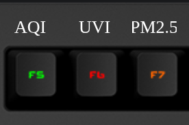

# 🌿 Air Quality Monitor - USA

This applet's source code can be found [here](https://github.com/daskeyboard/daskeyboard-applet--air-quality-monitor-usa).

Track your local environmental health in real time using this applet for Das Keyboard Q.
It displays live **AQI**, **UV Index**, and **PM2.5** readings across three dedicated keys on your keyboard giving you instant visual feedback at a glance.

---

## 🌤️ Features

- 🟢 **Green** when air quality and UV exposure are good
- 🟡 **Yellow** for moderate caution
- 🟠 **Orange** when conditions are unhealthy for sensitive groups
- 🔴 **Red** when conditions are poor
- 🟣 **Purple** for a very high UV index or severe pollution
- 🟤 **Maroon** for extremely severe pollution
- 💡 Displays **three live metrics** on **three separate keys** (from left to right):
  - **AQI** (Air Quality Index)
  - **UV Index** (sun exposure risk)
  - **PM2.5** (fine particulate pollution)
- 📡 Uses accurate real-time data from [Open-Meteo Air Quality API](https://open-meteo.com/en/docs/air-quality-api)

---

## ⚙️ Setup Instructions

1. **Install the applet** via the Das Keyboard Q software
2. **Assign it to any 3 adjacent keys** on your Q device
3. **Enter your latitude and longitude** and choose between the US AQI or the European AQI in the applet configuration
4. **Watch the key light up** based on the air quality around you!

---

## 🇺🇸 Entering Your Location (USA Only)

To track local environmental data, just enter your **5-digit US postal code**.

You can find your postal code by:

- Checking your mailing address
- Searching online: “postal code for [Your City, State]”
- Using your phone’s weather app or GPS
